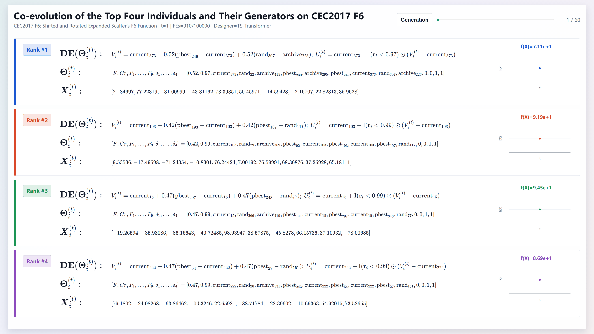

# LivingEA: An Ever-Evolving Evolutionary Algorithm Paradigm via Individual-Level Time-Varying Neural Design

This repository provides the official implementation for **LivingEA**, an automated algorithm design (AAD) paradigm that enables evolutionary algorithms to evolve dynamically at the individual level throughout the optimization process.

> 📌 Unlike conventional evolutionary algorithms with fixed structures or population-level adaptation rules, **LivingEA treats algorithm design as a sequential parameter-control problem**. Each candidate solution is associated with an individual-specific and time-varying algorithm generator, allowing the candidate solutions and their corresponding algorithmic behaviors to evolve jointly during optimization.

The first instantiation of the LivingEA paradigm is **LivingDE**, developed based on Differential Evolution (DE).

---

## 🧬 Methodological Highlights

LivingEA introduces an **individual-level time-varying neural algorithm design paradigm**, where the mathematical model governing candidate generation is no longer fixed during optimization.

### 🔄 Co-Evolution of Solutions and Their Generators

  

This GIF illustrates the reciprocal co-evolutionary process between candidate solutions and the mathematical models governing their generation. Through this closed-loop interaction, the resulting algorithm ceases to be a static entity and instead resembles a dynamic, individual-specific living system that undergoes adaptive evolution in real time.

### 🧩 Overall Methodology

  

The figure illustrates the main methodology of the LivingEA paradigm after AAD modeling. Neural designers are trained through a three-tier nested meta-training framework during the training phase and then deployed in a zero-shot manner under Q-learning-based scheduling to generate EAs for unseen problems during the testing phase.

The main characteristics include:

- **Individual-Level Algorithm Design**  
  Instead of applying one shared configuration to the entire population, LivingEA generates a specific algorithmic configuration for each individual at every iteration.

- **Time-Varying Algorithm Structure**  
  Algorithm parameters and operator decisions change dynamically according to the temporal search trajectory of each individual.

- **Unified Algorithm Design Space**  
  Continuous parameters and discrete operator decisions are mapped into a unified continuous representation, allowing automated algorithm design to be formulated as a generalized parameter-control problem.

- **Temporal Neural Algorithm Designers**  
  Two lightweight heterogeneous sequence models, a **Temporal Convolutional Network (TCN)** and a **Time-Series Transformer (TS-Transformer)**, learn algorithm design policies from historical evolutionary trajectories.

- **Dynamic Designer Scheduling**  
  A **Q-learning scheduler** dynamically coordinates the two neural designers during optimization.

- **Co-Evolution of Solutions and Their Generators**  
  Candidate solutions influence future algorithm-design decisions through trajectory feedback, while the generated algorithms determine subsequent solution evolution.

---

## 🔬 LivingDE

LivingDE instantiates the LivingEA paradigm using Differential Evolution.

Its algorithm design space contains both continuous and discrete variables, including:

- scaling factor \(F\),
- crossover rate \(Cr\),
- individual-selection strategies,
- operands of difference vectors,
- activation switches of differential components.

The resulting DE is therefore not represented by a single static mutation strategy. Instead, its search behavior may vary across both **individuals** and **iterations**.

---

## 🌐 Zero-Shot Generalization

The neural algorithm designers are trained only on **10-dimensional optimization problems**.

Without retraining, the learned design policies are directly deployed to:

- unseen CEC benchmark functions,
- unseen problem dimensions,
- large-scale optimization problems up to **1000 dimensions**, and
- real-world optimization problems.

This setting is used to investigate whether algorithm-design knowledge learned from low-dimensional search trajectories can generalize to substantially different optimization scenarios.

---

## 🔍 Explainability

LivingEA incorporates a dual-view post-hoc explainability framework.

### SHAP-based Neural Decision Analysis

SHAP is used to quantify how evolutionary trajectory features influence the algorithm-design decisions generated by the neural designers.

The analyzed trajectory features include:

- relative fitness,
- spatial proximity,
- historical success rate.

### Search Trajectory Network

Search Trajectory Networks (STNs) are used to visualize the resulting evolutionary search behaviors after the generated algorithmic decisions are executed.

Together, these two perspectives provide complementary explanations of:

1. **why** the neural designers generate particular algorithmic decisions, and  
2. **how** these decisions affect the subsequent search process.

---

## 🛠️ Code and Reproduction

The complete runnable source code of **LivingEA/LivingDE** has been publicly released in this repository to facilitate reproducibility and further research.

The repository provides the full implementation of the proposed method together with representative experimental settings and supporting materials. While not all test scenarios reported in the manuscript are included, the released code can be directly executed and extended to other benchmark and application settings.

Additional documentation and supporting resources may be added in future updates.

---

## 💻 Requirements

The practical training time depends on both CPU performance and the number of available CPU cores, while the degree of parallelism also affects the actual RAM consumption.

---

## 📄 Paper

Our manuscript:

**"LivingEA: An Ever-Evolving Evolutionary Algorithm Paradigm via Individual-Level Time-Varying Neural Design"**

is currently under revision for *IEEE Transactions on Evolutionary Computation*.

Paper access: **Coming soon**

---

## ⚠️ Notice

This repository is maintained as the official project page and implementation repository for **LivingEA**.

The complete runnable source code of LivingEA/LivingDE is publicly available. Representative experimental settings and supporting materials are also provided, while not all test scenarios reported in the manuscript are included. Additional documentation and supporting resources may be added in future updates.

---

## 📖 Citation

Citation information will be provided after the final bibliographic record becomes available.
